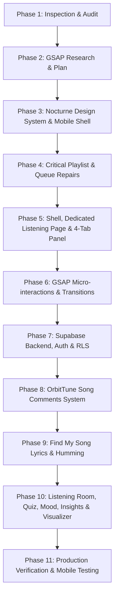

# OrbitTune — Implementation Audit & Source Inspection

> **Phase 1 Deliverable** — Comprehensive inspection of existing codebase, dependencies, architecture, state management, verified bugs, and transformation roadmap.
> Date: November 2026

---

## 1. Executive Summary & Stack Verification

OrbitTune is an editorial, high-fidelity music streaming web application currently powered by Next.js 16 (App Router with Turbopack), React 19, TypeScript, Tailwind CSS v4, Zustand, Dexie (IndexedDB), and Framer Motion. Audio streaming relies on unofficial YouTube Music Innertube API and `@distube/ytdl-core`. Synchronized lyrics are integrated via LRCLIB.

### Verified Technology Versions (`package.json`)
| Package | Version in Code | Role |
| :--- | :--- | :--- |
| `next` | `16.4.6` | App Router, React 19 server/client components, Turbopack |
| `react` / `react-dom` | `19.3.0` | UI Runtime |
| `typescript` | `^5` | Strict TypeScript compilation (`tsc --noEmit` clean) |
| `tailwindcss` | `4.3.3` | Tailwind v4 with `@tailwindcss/turbopack` and CSS `@theme` |
| `zustand` | `^5.1.0` | Global client player state (`usePlayerStore`) |
| `dexie` / `dexie-react-hooks` | `^4.4.7` / `^4.4.0` | Client-side persistent database (`OrbitTuneDatabase` v2) |
| `framer-motion` | `^14.14.0` | Animations, modals, slide-overs |
| `lucide-react` | `^1.73.0` | System iconography |
| `youtubei.js` | `^18.3.0` | Innertube API client for catalog, search, artist metadata |
| `@distube/ytdl-core` | `^5.2.1` | Audio format & stream extraction |

---

## 2. Architecture & File Hierarchy Map

```
Website Version/
├── docs/                        # Architecture, Design System, Features, Music Engine docs
├── src/
│   ├── app/
│   │   ├── layout.tsx           # Global shell: AmbientBackground, AudioController, Sidebar, Player
│   │   ├── globals.css          # Nocturne design tokens (@theme), light mode, keyframes
│   │   ├── page.tsx             # Home feed (Trending Spotlight, Quick Picks, Explore sections)
│   │   ├── search/page.tsx      # Global search & genre tiles
│   │   ├── library/page.tsx     # Liked songs, custom playlists, listening history, CSV I/O
│   │   ├── playlist/page.tsx    # Playlist detail view (rename, reorder, delete, search tracks)
│   │   ├── artist/page.tsx      # Artist profile with Top Songs, Albums, Singles, Related
│   │   ├── info/page.tsx        # System statistics, info, support
│   │   └── api/
│   │       ├── search/route.ts
│   │       ├── explore/route.ts
│   │       ├── lyrics/route.ts
│   │       ├── recommendations/route.ts
│   │       ├── artist/route.ts
│   │       └── stream/[id]/route.ts
│   ├── components/              # 16 shared UI components
│   ├── hooks/                   # useVolumeWheel
│   ├── lib/
│   │   ├── db.ts                # Dexie OrbitTuneDatabase schema
│   │   ├── youtube.ts           # Innertube & ytdl core integration
│   │   ├── lyrics.ts            # LRCLIB fetch and LRC parser
│   │   ├── recommender.ts       # Smart autoplay scoring matrix
│   │   └── a11y.ts              # Keyboard accessibility helper
│   ├── store/
│   │   ├── usePlayerStore.ts    # Central audio playback and queue state
│   │   └── usePlaylistDialog.ts # AddToPlaylistDialog visibility and payload
│   └── types/
│       └── music.ts             # Core domain models (Track, SyncedLyrics, RecommendedTrack)
```

---

## 3. State Management & Persistence Audit

1. **Zustand (`src/store/usePlayerStore.ts`)**:
   - Manages: `currentTrack`, `isPlaying`, `isBuffering`, `currentTime`, `duration`, `volume`, `isMuted`, `queue`, `queueIndex`, `isShuffle`, `repeatMode`, `showLyrics`, `lyrics`, `isExpanded`, `isQueueDrawerOpen`, `smartAutoplayEnabled`, `recommendationQueue`.
   - Direct audio element coupling: `document.getElementById('orbit-audio-player')` for imperative `seekTo` and `setVolume`.
   - **Gap**: Volume and playback state are not persisted across reloads.
2. **IndexedDB (`src/lib/db.ts` - Dexie `OrbitTuneDatabase`)**:
   - `likedTracks` (Key: `id`): Saved songs with `likedAt` timestamp.
   - `playlists` (Key: `id`): Playlists with embedded `tracks: Track[]`, `createdAt`, `updatedAt`, `coverUrl`, `description`.
   - `history` (Auto `id`): Chronological playback logs with `playedAt`.
   - `userFeedback` (Auto `id`): ML signals (`complete_play`, `liked`, `early_skip`, `dismissed_recommendation`).
   - `recommendationCooldowns` (Key: `trackId`): 2.5-hour cooldown trackers.
3. **Web Storage**:
   - `sessionStorage['orbittune:home:v2']`: 15-minute home feed cache snapshot.
   - `localStorage['orbittune-theme']`: `'dark' | 'light'` theme preference.

---

## 4. Comprehensive Audit of Bugs & Gaps

### 4.1 Critical Playlist System Gaps (Addressed in Phase 4)
- **Mobile Touch Inaccessibility**: On `TrackCard` and `TrackRow`, the Add-to-Playlist (`Plus`/`ListPlus`) buttons have `opacity-0 group-hover:opacity-100`. On touch devices with no pointer hover, buttons are completely invisible and inaccessible.
- **Empty Track Array Crash Risk**: In `AddToPlaylistDialog.tsx`, adding to a playlist assumes `selected.tracks` is always defined (`[...selected.tracks, track]`). If a record has `undefined` or corrupt tracks, it crashes.
- **Missing In-Player Action**: Neither `BottomPlayer` nor `ExpandedPlayer` has an Add-to-Playlist button for the currently playing track.
- **Playlist Page Fallback on Search & Explore**: Clicking playlists/albums in search or artist pages redirects to `/search?q=...` instead of opening the dedicated playlist/album view.

### 4.2 Application Shell & YouTube Music Structure Gaps
- **Missing Top Navigation Bar**: No persistent top navigation with Back/Forward controls, unified search bar, user auth/profile avatar, or route status.
- **Missing Dedicated Listening Page with 4-Tab Context Panel**: The desktop layout lacks the YouTube Music reference 4-tab panel (Up Next, Lyrics, Comments, Related). Currently, only an ExpandedPlayer modal exists.
- **Missing Mobile Navigation & Sheet System**: Mobile navigation relies solely on a basic bottom tab bar (`MobileNav`); missing a dedicated mobile mini-player transition to mobile expanded player and mobile context sheets.
- **Sidebar Collapsed State**: Sidebar is hardcoded at `w-60` desktop-only, without icon-only collapsed state.

### 4.3 Supabase & Backend Gaps
- No Supabase client, migrations, or auth configured.
- No user accounts or cross-device cloud synchronization.
- No community comments table, likes, or moderation.

### 4.4 Music Discovery & Interactive Features Gaps
- **Find My Song**: Not implemented (lyrics search + audio singing/humming recognition adapter).
- **Listening Room**: Not implemented (social room sync).
- **Music Quiz**: Not implemented (interactive trivia).
- **Mood Selector**: Hardcoded genres exist, but interactive mood curation is missing.
- **Listening Insights**: Only a basic count exists on `/info`; advanced listening stats/charts are missing.
- **Audio Visualizer**: Missing in Expanded Player.

### 4.5 Styling & Nocturne Design Audit
- Palette: Dark mode tokens are defined in `globals.css` (`#101114` canvas, `#C9A94D` champagne gold).
- Hardcoded dark values remain in components: `#101114` hardcoded in buttons (`text-[#101114]`), genre tiles use hardcoded Unsplash photos with legacy borders.
- Strict restriction enforced: **No pink/magenta** (remove any legacy `#EC4899` or rose badges).

---

## 5. Implementation Roadmap & Architecture Strategy



This audit establishes the baseline for all subsequent phases.
