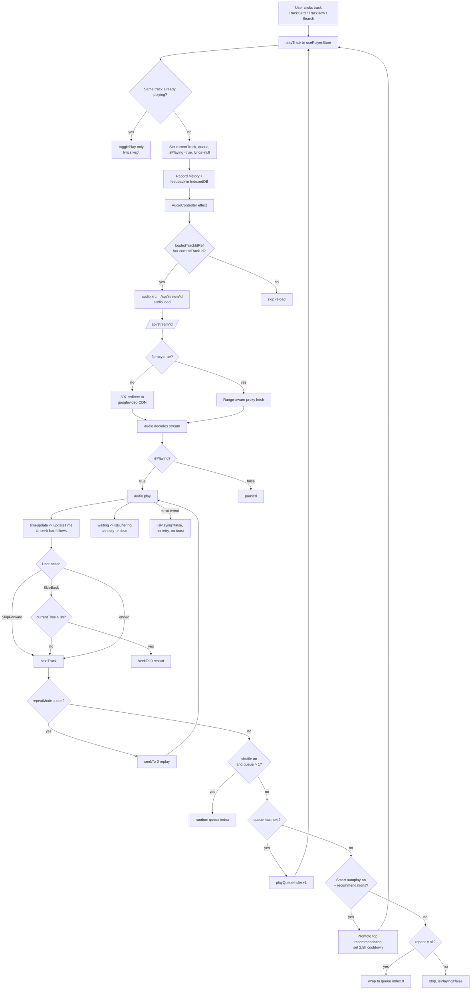

# OrbitTune — Music Playback Engine

> Sources: `src/components/AudioController.tsx` (audio element + events), `src/store/usePlayerStore.ts` (state & logic), `src/app/api/stream/[id]/route.ts` (URL resolution), `src/lib/youtube.ts` (`getStreamUrl`).

## 1. Audio Engine Architecture

The engine is a **plain HTML5 `<audio>` element**, not a media library:

- A single headless element `<audio id="orbit-audio-player">` is rendered by `AudioController` inside the root layout (`src/app/layout.tsx`), so it survives all route changes. It has no visible UI of its own.
- `AudioController` (13–133 lines) is the only component that drives the element's playback API; it acts as a **bridge between DOM audio events and the Zustand store**.
- Store actions also reach the element **directly** via `document.getElementById('orbit-audio-player')` for imperative operations (`seekTo` line 296, `setVolume` line 311, and the ended-handler logic) — a deliberate two-way coupling.

## 2. Stream URL Pipeline

1. When `currentTrack` changes (`loadedTrackIdRef` guard in `AudioController`), the controller sets `audio.src = /api/stream/{track.id}` and calls `audio.load()`. This happens **once per track**, even if play/pause toggles.
2. `/api/stream/[id]` (`src/app/api/stream/[id]/route.ts`):
   - Calls `getStreamUrl(id)` in `src/lib/youtube.ts`, which resolves the **highest-bitrate audio-only format** via `@distube/ytdl-core` (`getYtdl()` singleton).
   - Default mode: **HTTP 307 Temporary Redirect** to the googlevideo.com CDN URL (browser streams directly; CORS `*`, `Cache-Control: no-cache`).
   - `?proxy=true` mode: server fetches the audio and relays it with **Range header passthrough** (needed if the CDN blocks direct browser requests); response `Content-Type: audio/mp4`.
   - The app itself always uses the redirect mode (`AudioController` hardcodes `/api/stream/${id}` without the proxy param).
3. Stream URLs are resolved per-play; they are never cached or persisted (they expire on YouTube's side).

## 3. Play / Pause Logic

- `playTrack(track, newQueue?)` (`usePlayerStore.ts`): sets `currentTrack`, rebuilds queue when `newQueue` provided, resets lyrics (`lyrics: null`), sets `isPlaying: true`, records `complete_play` feedback for the previously playing track if it qualified, inserts a `history` record in IndexedDB, and kicks off smart-autoplay preparation.
- Clicking the currently active track toggles play/pause **without** restarting or wiping lyrics (line 117 comment; avoids re-fetch).
- `togglePlay`, `pause`, `resume` are simple state toggles; `AudioController` reacts: `isPlaying` → `audio.play()` (promise rejection ignored via catch), pause → `audio.pause()`.

## 4. Track Selection, Next / Previous

- `nextTrack()` (called on `ended` event or SkipForward):
  - Repeat-one → `seekTo(0)` and keep playing.
  - Queue has a next index → play it.
  - End of queue → smart autoplay takes **precedence over repeat-all**: if `smartAutoplayEnabled` and `recommendationQueue` non-empty, the top recommendation is promoted into the queue (2.5 h cooldown set in `recommendationCooldowns`, line 490–495); only when smart autoplay is off (or has no recommendations) does `repeatMode === 'all'` wrap to queue index 0 (`src/store/usePlayerStore.ts` lines 261–269).
  - Shuffle (with queue length > 1) is checked before the sequential-advance branch: it picks a random index and plays it (lines 245–250).
- `prevTrack()` (line 275): if `currentTime > 3` (seconds) → restart current track (`seekTo(0)`); otherwise jump to `queueIndex - 1`, wrapping to the last item when at 0.
- `playQueueIndex(index)`: jump straight to a queue position.

## 5. Queue Management

- `queue: Track[]` + `queueIndex` in the store. Play actions pass a `newQueue` (e.g. a section's tracks); single-track plays set a one-item queue.
- `clearQueue()` empties the queue; the QueueDrawer's Clear button uses it.
- **Shuffle** (`toggleShuffle`, `isShuffle` boolean): the queue order is not physically re-ordered; shuffle affects index advancement — with shuffle on, `nextTrack` picks a random queue position. `repeatMode: 'off' | 'all' | 'one'` cycled by `toggleRepeat`.

## 6. Volume & Mute

- `setVolume(vol)` clamps 0–1, sets `isMuted: vol === 0`, and writes directly to the audio element (`audio.volume`, `audio.muted`).
- Volume slider + wheel nudges (±0.05) in BottomPlayer/ExpandedPlayer; mute button with 3-state icon (Volume2/Volume1/VolumeX).
- **Not persisted:** volume/mute reset to defaults on reload (no storage key).

## 7. Progress, Seeking, Buffering

- `AudioController` listens to `timeupdate` → `updateTime(currentTime, duration)` (store keeps `currentTime`/`duration`).
- `seekTo(seconds)` writes both store state and `audio.currentTime` (line 296–302). Seek bars are custom overlays over hidden `<input type="range">`; wheel on the bar seeks ±5 s.
- `waiting` event → `setIsBuffering(true)`; `canplay` → `setIsBuffering(false)`. Buffering shows a loader in the player UI.
- `loadingTrackId` in the store gives per-track loading feedback in cards/rows.

## 8. Error Handling

- `error` event on the audio element → `setIsBuffering(false)` and `set({ isPlaying: false })`; playback just stops — **no retry, no user-facing error message** (verified in `AudioController`).
- Stream route returns 400 (no id) or 500 (resolution failure) as JSON; a failed redirect would surface as the audio element's error event.
- `play()` promise rejections (autoplay policy, abort on track change) are caught and ignored.

## 9. Feedback Signals (smart autoplay input)

Recorded into Dexie `userFeedback` via `recordFeedback` (`usePlayerStore.ts` line 66, 232–234):

| Signal | Condition |
| :--- | :--- |
| `complete_play` | Track's `ended` event fires (or replaced after meaningful play) |
| `early_skip` | Skipped while `currentTime < 25` and `duration > 45` (lines 232–234) |
| `liked` | Heart pressed |
| `dismissed_recommendation` | X pressed on a recommendation in QueueDrawer |

## 10. Background Playback & MediaSession

- Audio keeps playing during tab switches/route changes (the element is layout-level; nothing pauses on navigation).
- `AudioController` wires **MediaSession API**: metadata (title, artist, album, artwork from `getHighResCover`) and handlers for `play`, `pause`, `nexttrack`, `previoustrack`, `seekto`. OS lock-screen controls therefore work.
- No wake-lock, no picture-in-picture.

## 11. Persistence of Playback State

**Not implemented.** On reload: playback stops, `currentTrack` is null, the player bar is hidden until a track is played. No sessionStorage/localStorage key exists for playback state. Volume resets to default (store default), theme is the only persisted preference.

## 12. Playback Lifecycle (Mermaid)

## 13. Lyric Synchronization (playback-coupled)

`ExpandedPlayer` polls `currentTime` and highlights the last `lyrics.lines[]` entry whose `time` <= currentTime; clicking a lyric line seeks there. Lyrics fetched once per track via `/api/lyrics` (`src/lib/lyrics.ts`, LRCLIB).

## 14. Summary of Gaps (verified)

- No playback/volume persistence across reloads.
- No error UI or retry on stream failure.
- No crossfade/gapless features; plain element-to-element switching.
- No proxy-mode usage from the app itself (route supports it; UI doesn't expose it).
- Shuffle re-picks randomly but `repeat=all` wraps the physical queue rather than shuffling it.

## Cross-references

- Store schema & IndexedDB feedback tables: docs/DATA_STRUCTURE.md
- Streaming API route contract: docs/ROUTES.md
- Smart autoplay scoring details: docs/ARCHITECTURE.md §8.5
